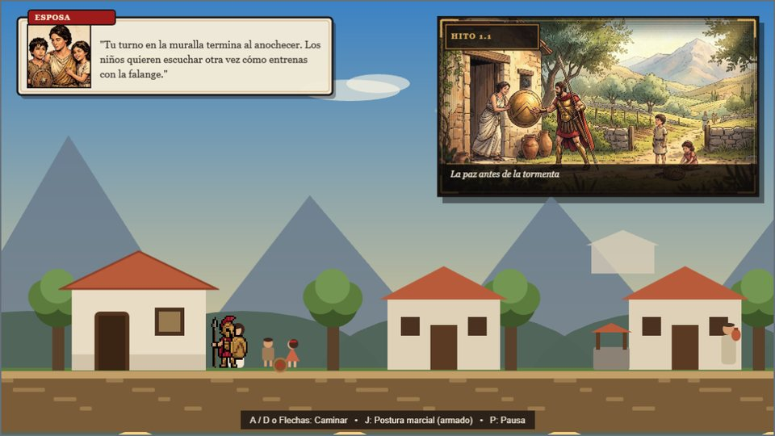
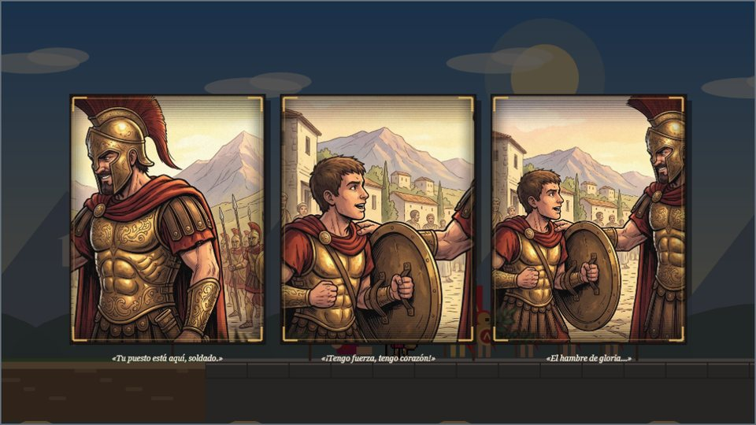
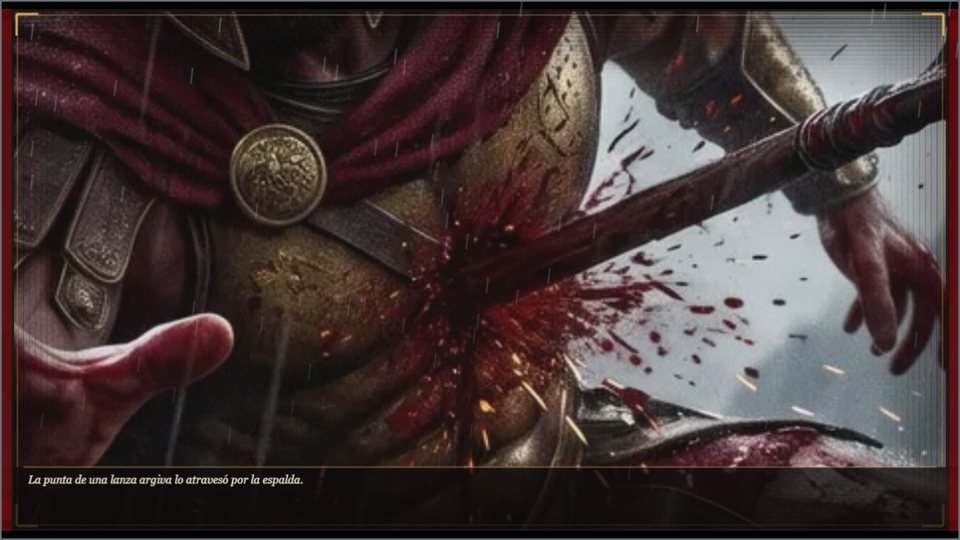
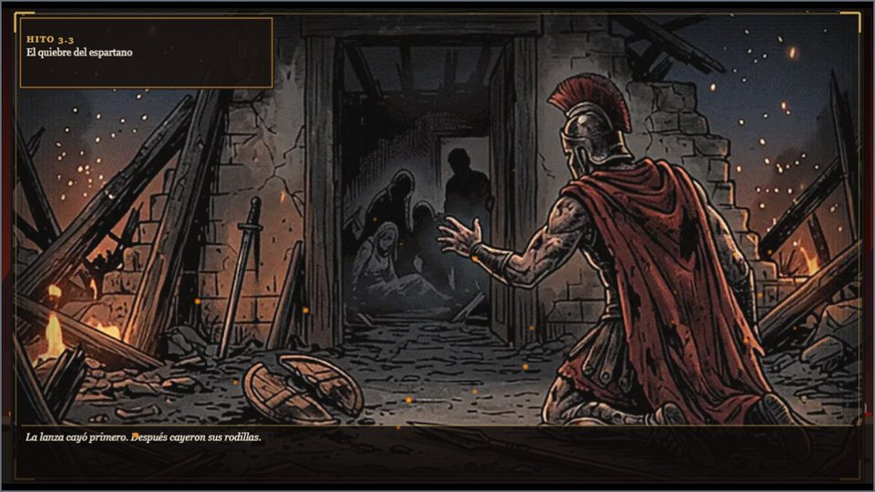

<div align="center">

# THE LAST SPARTAN

### Parte 1 · El Precio de la Gloria

*Un soldado sale a buscar gloria y vuelve a casa demasiado tarde.*

<br>


</div>

---

## La idea

No es un plataformas con texto encima, ni una novela gráfica con un botón de *continuar*.

**The Last Spartan** alterna tres registros para contar el mismo relato: recorres el pueblo y peleas en 2D, y en los momentos que importan la escena se abre en **viñetas de cómic** o en **ilustraciones cinematográficas animadas** —sin que el juego deje de ser un juego—. Las ilustraciones no son pantallas de carga: entran, respiran y se retiran.

<br>

<table>
  <tr>
    <td width="50%"><br><sub><b>Escena 1</b> · la ilustración entra mientras sigues caminando</sub></td>
    <td width="50%"><br><sub><b>Escena 1</b> · cierre en página de cómic de tres paneles</sub></td>
  </tr>
  <tr>
    <td width="50%"><br><sub><b>Escena 2</b> · cuatro planos para la muerte del ídolo</sub></td>
    <td width="50%"><br><sub><b>Escena 3</b> · el umbral, ilustración animada de 30 fotogramas</sub></td>
  </tr>
</table>

---

## Lo que hay dentro

| | |
| :--- | :--- |
| **3 escenas** | Campaña completa de la Parte 1, con 9 hitos narrativos. |
| **4 estados del soldado** | Guardia pacífico, combate activo, huida herido y sprint desesperado. |
| **9 ilustraciones** | Plates cinematográficos de 1920 px, uno de ellos **animado** (30 frames). |
| **12 retratos HD** | Expresiones con grado de color propio para las viñetas de diálogo. |
| **Combate de falange** | Estocada en combo, barrido pesado, guardia férrea y golpe de escudo. |
| **Modo combate directo** | Escenario independiente con hacha, lanza detonable y jefes. |
| **Audio procedural** | Todo el sonido se sintetiza con la Web Audio API: cero archivos de audio. |

<br>

### Campaña

| Escena | Hitos | Qué cuenta |
| :--- | :--- | :--- |
| **1 · El Escudo del Pueblo y el Llamado de la Sangre** | 1.1 La paz antes de la tormenta · 1.2 El mensajero y el general · 1.3 La arrogancia del soldado | El día que Esparta lo llama a filas y él confunde el deber con la ambición. |
| **2 · El Barro, la Lanza y la Caída** | 2.1 El choque contra Argos · 2.2 La muerte del ídolo · 2.3 La huida deshonrosa | La emboscada en el desfiladero, la lanza por la espalda y la huida. |
| **3 · Cenizas del Deber** | 3.1 El humo en el horizonte · 3.2 El recorrido del horror · 3.3 El quiebre del espartano | El regreso al pueblo quemado y lo que encuentra en el umbral de su casa. |

---

## Controles

**Escena 1 — recorrido y diálogo**

| Tecla | Acción |
| :--- | :--- |
| `A` `D` / `←` `→` | Caminar por el pueblo |
| `E` (cerca de un personaje) | Hablar con familiares y vecinos (objetivo opcional) |
| `E` / acercarse | Hablar con el General (en la plaza) |
| `J` | Postura marcial (una vez armado) |
| `ENTER` | Avanzar una cinemática cuando ya la leíste |
| `P` | Pausa |

**Escena 2 — combate con Dory y Hoplón**

| Tecla | Acción |
| :--- | :--- |
| `A` `D` / `←` `→` | Moverse |
| `J` | Estocada rápida (combo x3) |
| `K` | Barrido / estocada pesada |
| `Shift` / `L` | Guardia férrea |
| `Shift` + `J` | Golpe de escudo (rompe guardia) |
| `S` / `↓` | Agacharse ante las flechas (huida) |
| `ENTER` | Avanzar una cinemática cuando ya la leíste |
| `P` | Pausa |

**Escena 3 — el regreso**

| Tecla | Acción |
| :--- | :--- |
| `A` / `←` | Avanzar hacia el hogar (el sprint es automático) |
| `E` | Umbral de casa |
| `P` | Pausa |

**Modo combate directo**

| Tecla | Acción |
| :--- | :--- |
| `1` / `2` | Hacha / Lanza |
| `J` | Atacar |
| `K` | Detonar lanzas clavadas |
| `W` / `Espacio` | Saltar |

---

## Bajo el capó

Phaser 4 sobre módulos ES nativos, sin bundler ni framework de UI: se abre `index.html` y ya está. El código está separado por responsabilidad y el arte no vive dentro del código, sino en configuración declarativa.

```text
mi-primer-juego/            # lo único que se publica
├── index.html              # entrada: phaser.min.js + src/main.js
├── lib/phaser.min.js       # copiado desde node_modules en postinstall
├── assets/
│   ├── cine/               # plates, retratos HD y hoja de sprites animada
│   └── sprites/            # skins y spritesheets del soldado
└── src/
    ├── config/             # constantes, layouts, assets, cinemáticas, animaciones
    ├── entities/           # SpartanPlayer (4 estados), IA y oleadas de Argos
    ├── managers/           # audio, narrativa de cómic, dirección cinematográfica
    ├── ui/                 # viñetas, bocadillos, HUD, plates cinematográficos
    └── scenes/             # Boot, Menú, Escenas 1-3, combate, pausa, finales
```

### El sistema cinematográfico

Tres piezas hacen el trabajo:

- **`cinematicConfig.js`** — datos puros: qué ilustración, qué encuadre (`focus` normalizado), cuánto zoom, cuánto desplazamiento y qué texto.
- **`CinematicPlate.js`** — dibuja el plate: Ken Burns, grano de película, viñeteado, marco de tinta, sello de capítulo y banda de narración. El encuadre se resuelve recortando la textura con un frame propio por plate, así la imagen se mueve por debajo mientras el marco queda inmóvil.
- **`CinematicDirector.js`** — decide *cuándo*: cinemática a pantalla completa con letterbox, viñeta insertada que no detiene el juego, corte seco de montaje, secuencia de planos o página de cómic de tres paneles.

Las ilustraciones animadas funcionan igual, pero con un `Sprite` en lugar de una `Image`: el GIF se convirtió antes en una hoja de sprites para que Phaser pueda reproducirlo.

---

## Ejecutar en local

Requisitos: **Node.js 18+** y, solo si vas a regenerar arte, **Python 3** con Pillow.

```bash
npm install        # instala Phaser y copia el bundle a mi-primer-juego/lib/
npm start          # sirve el juego en local
```

Alternativa sin npm:

```bash
python -m http.server 8000
# abre http://localhost:8000/mi-primer-juego/
```

> Hace falta un servidor: el juego usa módulos ES, así que no funciona abriendo el archivo directamente.

---

## Pipeline de arte

El arte fuente **no se publica**: vive en `art-source/` y de ahí se generan los recursos optimizados que sí carga el juego.

```bash
python tools/prepare_cinematics.py              # plates + retratos + hojas de sprites
python tools/prepare_cinematics.py --only plates
python tools/prepare_cinematics.py --only portraits
python tools/prepare_cinematics.py --only gifs
```

| Entrada (`art-source/`) | Salida (`mi-primer-juego/assets/cine/`) |
| :--- | :--- |
| Ilustraciones de hito (2752×1536) | Plates de 1920 px, ~250-400 KB cada uno |
| Retratos de personaje | Recortes cuadrados de 512 px con grado de color |
| `Hito3_3.gif` (30 frames) | Hoja de sprites 4×8 en WebP, ~2,8 MB |

Los originales nunca se tocan. Para cambiar un encuadre solo se edita `cinematicConfig.js`; para añadir una ilustración, se deja el archivo en `art-source/` y se vuelve a ejecutar el script.

---

## Publicar en GitHub Pages

El workflow [`deploy-pages.yml`](./.github/workflows/deploy-pages.yml) se dispara en cada push a `main` o `master`:

1. `npm ci` instala dependencias y copia el bundle de Phaser.
2. Publica la carpeta `mi-primer-juego` (solo el juego, sin el arte fuente ni el pipeline).

Configuración en GitHub: **Settings → Pages → Source: GitHub Actions**. La URL queda como `https://<usuario>.github.io/<repositorio>/`.

---

## Estado

**Parte 1 completa y jugable de principio a fin**, con la capa cinematográfica integrada en las tres escenas.

Siguientes pasos posibles:

- Skins y animaciones propias para los enemigos de Argos, el General y los aliados (el jugador ya está migrado).
- Pantalla de carga con progreso: hoy el arte cinematográfico se precarga completo en `BootScene`.
- Una eventual **Parte 2**, si la historia sigue.

<div align="center">
<br>
<sub>Hecho con Phaser 4 · arte, código y sonido generados para este proyecto</sub>
</div>
